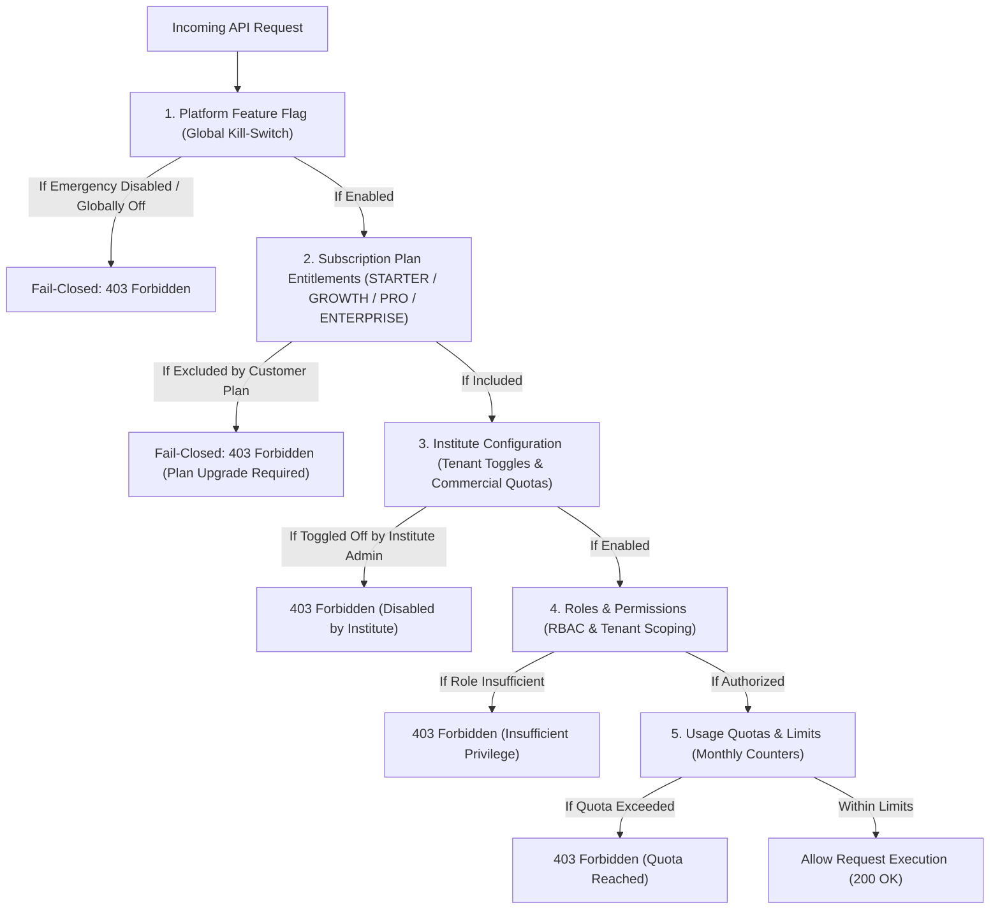

# PadhaiPilot — Centralized Global Feature Flag & Entitlement System

## 1. Executive Overview

PadhaiPilot employs a centralized, database-backed, multi-tenant feature flag and commercial entitlement engine. The system decouples platform release management, commercial plan packaging, institute customizations, and security authorization into distinct, deterministic layers.

Runtime configuration changes become effective across web applications and the mobile app without requiring frontend rebuilds or backend redeployments.

---

## 2. Four Distinct Architectural Concepts

PadhaiPilot strictly maintains separation of concerns between four distinct layers:



### A. Platform Feature Flags (`PlatformFeatureFlag`)
- Authoritative control for platform-wide availability.
- Managed exclusively by Platform Super Admins.
- **Emergency Kill Switch**: Immediately overrides all plan entitlements and institute settings. Fail-closed across all endpoints.

### B. Subscription Plan Entitlements (`PlanEntitlement`)
- Packaging of features into commercial tiers (`STARTER`, `GROWTH`, `PRO`, `ENTERPRISE`).
- Defines whether a feature is included and its default monthly quota (e.g. max active students, bulk PDF generations per month).
- An institute cannot enable a feature excluded by its plan without an authorized commercial exception.

### C. Institute Configuration (`InstituteFeatureConfig`)
- Per-tenant toggles within plan limits.
- An institute administrator can disable an otherwise eligible feature (e.g. disabling online homework if they operate offline).
- An institute may receive custom quota overrides granted by Super Admins as commercial exceptions.

### D. Roles and Permissions (RBAC)
- Role verification (`SUPER_ADMIN` > `INSTITUTE_ADMIN` > `TEACHER` > `STUDENT`).
- A feature being enabled for an institute **never** bypasses identity or resource ownership checks.
- Server-side guards (`FeatureFlagGuard`) independently verify tenant boundaries and roles.

---

## 3. Canonical Feature Registry

All platform features are authoritatively declared with strict TypeScript types in `@padhai-pilot/shared`:

| Feature Key | Owning Module | Default Scopes | Default Plan Availability | Emergency Killable |
| :--- | :--- | :--- | :--- | :--- |
| `attendance` | `ACADEMIC_OPS` | Platform, Plan, Institute | All Plans (Starter: 100 students, Growth: 500, Pro: 2000, Enterprise: Unlimited) | Yes |
| `assignments` | `ACADEMIC_OPS` | Platform, Plan, Institute | All Plans | Yes |
| `bulk_marks_entry` | `ASSESSMENT` | Platform, Plan, Institute | All Plans | Yes |
| `exam_management` | `ASSESSMENT` | Platform, Plan, Institute | All Plans | Yes |
| `question_bank` | `ASSESSMENT` | Platform, Plan, Institute | All Plans | Yes |
| `published_results` | `ASSESSMENT` | Platform, Plan, Institute | All Plans (requires `bulk_marks_entry`) | Yes |
| `staff_leave_management` | `ACADEMIC_OPS` | Platform, Plan, Institute | All Plans | Yes |
| `timetable` | `ACADEMIC_OPS` | Platform, Plan, Institute | All Plans | Yes |
| `lesson_planning` | `ACADEMIC_OPS` | Platform, Plan, Institute | All Plans | Yes |
| `pdf_generation` | `SYSTEM_BRANDING` | Platform, Plan, Institute | All Plans (Starter: 100/mo, Growth: 1000/mo, Pro: 10000/mo) | Yes |
| `bulk_pdf_generation` | `SYSTEM_BRANDING` | Platform, Plan, Institute | Growth (5/mo), Pro (50/mo), Enterprise (Unlimited) | Yes |
| `bulk_import` | `ACADEMIC_OPS` | Platform, Plan, Institute | Growth (5/mo), Pro (50/mo), Enterprise (Unlimited) | Yes |
| `bulk_export` | `ACADEMIC_OPS` | Platform, Plan, Institute | Starter (1/mo), Growth (10/mo), Pro (Unlimited) | Yes |
| `fee_management` | `FINANCE` | Platform, Plan, Institute | Growth (200), Pro (Unlimited), Enterprise (Unlimited) | Yes |
| `fee_reminders` | `FINANCE` | Platform, Plan, Institute | Growth (100 SMS/mo), Pro (1000 SMS/mo) | Yes |
| `announcements` | `COMMUNICATIONS`| Platform, Plan, Institute | All Plans | Yes |
| `in_app_notifications` | `COMMUNICATIONS`| Platform, Plan, Institute | All Plans | Yes |
| `email_notifications` | `COMMUNICATIONS`| Platform, Plan, Institute | All Plans | Yes |
| `advanced_reports` | `REPORTS_ANALYTICS`| Platform, Plan, Institute | Growth, Pro, Enterprise | Yes |
| `white_label_branding`| `SYSTEM_BRANDING` | Platform, Plan, Institute | Pro (1 custom brand), Enterprise (Unlimited) | No |
| `custom_domains` | `SYSTEM_BRANDING` | Platform, Plan, Institute | Pro (1 CNAME), Enterprise (5 CNAMEs) | No |
| `parent_portal` | `STUDENT_PORTAL` | Platform, Plan, Institute | Pro, Enterprise | Yes |
| `mobile_features` | `ACADEMIC_OPS` | Platform, Plan, Institute | Growth, Pro, Enterprise | Yes |

---

## 4. Precedence Resolution Rules

When evaluating `FeaturesService.evaluateFeature({ featureKey, instituteId, userRole, requiredRole, metricKey })`:

1. **Step 1: Platform Feature Flags**:
   - If `isEmergencyDisabled == true` -> returns status: `EMERGENCY_KILLED`, `isAvailable: false`.
   - If `isGloballyEnabled == false` -> returns status: `GLOBALLY_DISABLED`, `isAvailable: false`.
2. **Step 2: Subscription Plan Entitlements**:
   - Queries `PlanEntitlement` for institute's plan (`STARTER`, `GROWTH`, `PRO`, `ENTERPRISE`).
   - If not included or default quota is 0 -> returns status: `PLAN_RESTRICTED`, `isAvailable: false`.
3. **Step 3: Institute Configuration Overrides**:
   - Queries `InstituteFeatureConfig` for `(instituteId, featureKey)`.
   - If `isEnabled == false` -> returns status: `INSTITUTE_DISABLED`, `isAvailable: false`.
4. **Step 4: Role & RBAC Check**:
   - If `requiredRole` is specified, checks if `userRole` has required weight (`SUPER_ADMIN` > `INSTITUTE_ADMIN` > `TEACHER` > `STUDENT`).
   - If insufficient -> returns status: `PERMISSION_DENIED`, `isAvailable: false`.
5. **Step 5: Usage Quotas & Limits**:
   - Compares active usage in `InstituteUsageCounter` against effective quota limit.
   - If `used >= limit` -> returns status: `QUOTA_EXCEEDED`, `isAvailable: false`.
6. **Pass**:
   - Returns status: `ACTIVE`, `isAvailable: true`.

---

## 5. Security & Fail-Closed Guard

In NestJS endpoints:

```typescript
@RequireFeature('bulk_marks_entry', 'TEACHER')
@Post('save-draft')
async saveDraft(...)
```

The `FeatureFlagGuard` intercepts requests before route handler execution:
- Extracts authenticated user and tenant (`x-institute-id` or `user.instituteId`).
- Evaluates the feature against precedence rules.
- If unavailable, throws `403 Forbidden` with a machine-readable JSON envelope:
  ```json
  {
    "statusCode": 403,
    "error": "Forbidden - Feature Restricted",
    "message": "Feature is not included in the 'STARTER' plan. Please upgrade your subscription.",
    "featureKey": "bulk_import",
    "status": "PLAN_RESTRICTED",
    "requiredPlan": "GROWTH"
  }
  ```

---

## 6. Audit & Emergency Controls

Every privileged change records an immutable entry in `FeatureAuditLog`:
- **`GLOBAL_TOGGLE`**: Platform Super Admin enabled or disabled a feature globally.
- **`EMERGENCY_KILL`**: High-impact emergency kill switch executed. Requires confirmation code `CONFIRM_KILL`.
- **`EMERGENCY_RESTORE`**: Emergency kill switch cleared after incident mitigation.
- **`PLAN_UPDATE`**: Plan entitlement or default quota updated.
- **`INSTITUTE_OVERRIDE`**: Institute enabled/disabled or custom commercial quota granted.

---

## 7. Caching & Invalidation Architecture

- **PostgreSQL** is the durable single source of truth.
- **Two-tier cache**: In-memory L1 cache with 60-second TTL + Upstash Redis L2 cache.
- **Explicit Invalidation**: Any toggle, emergency kill, or plan update immediately invalidates affected cache keys.
- **Outage Resilience**: If Redis is offline or unreachable, the system falls back to direct database queries with local caching, ensuring 100% fail-closed security.

